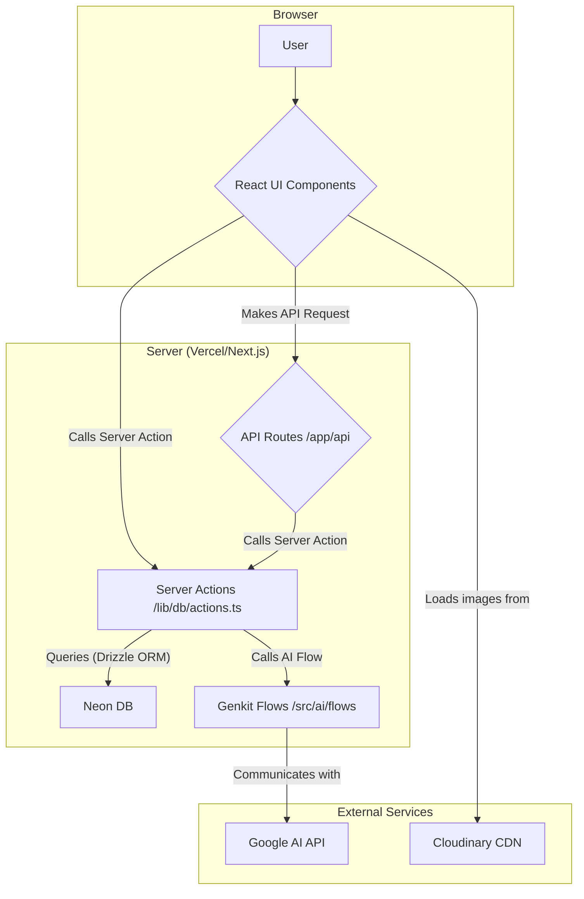

<div align="center">
  
  <h1 style="border-bottom: none; font-size: 2.5rem;"><strong>Spekulus</strong></h1>
  <p><strong>Reflect Smarter, Live Better.</strong></p>
  <p>The official informational website for the Spekulus smart mirror concept.</p>
</div>

<div align="center">

[](https://nextjs.org/)
[](https://react.dev/)
[](https://orm.drizzle.team/)
[](https://vercel.com/)
[](https://cloudinary.com/)

</div>

---

### **Welcome to the Spekulus Project! 👋**

This repository contains the source code for the official marketing website for **Spekulus**, a conceptual smart mirror designed to be the elegant centerpiece of your daily routine. We're excited to have you here.

## 💡 What is Spekulus?

Spekulus is more than just a mirror—it's a vision for a smarter way to live. It's an intelligent surface that provides personalized insights into your health, schedule, and environment without adding to your screen time.

**The Problem It Solves:** Our lives are cluttered with notifications and apps spread across multiple devices. Spekulus aims to centralize the essential information you need to start your day—skin analysis, stress levels, weather, and smart home controls—into a single, beautifully integrated device.

**Who It's For:**
- **Tech-Savvy Individuals:** People who love integrating smart technology into their homes.
- **Health & Wellness Enthusiasts:** Anyone looking for proactive ways to monitor their well-being.
- **Modern Homeowners:** Those who appreciate minimalist design and functional art.

---

## ✨ Key Features

This isn't just a static website. It's a fully dynamic, internationalized, and content-manageable platform.

*   **🌐 Multi-Language Support:** The entire site can be switched between **English**, **Ukrainian (Українська)**, and **Slovak (Slovenčina)**, with language preferences saved locally. All content is translatable via the admin panel.
*   **🔐 Full-Fledged Admin Panel:** Almost every piece of text, every image, and every configuration on the public site can be edited through a secure, password-protected admin panel. No code changes are needed for content updates!
*   **💾 Database-Driven Content:** All content is fetched from a Postgres database using **Drizzle ORM**, making the site fast, scalable, and easy to manage.
*   **🤖 AI-Powered Features:** Includes a Genkit-powered AI chatbot on creator pages that answers questions based on their profile data, providing an interactive user experience.
*   **🖥️ Responsive Design:** Built with Tailwind CSS and ShadCN UI, the site looks great on any device, from a large monitor to a mobile phone.
*   **📝 Developer Notes Blog:** A full-featured blog system with syntax highlighting, reactions, view counts, reading progress, series navigation, and social sharing.
*   **🖼️ Cloudinary CDN:** All images are served through Cloudinary for optimized loading with automatic format conversion and responsive sizing.

---

## 📝 Dev Notes Features

The developer notes section includes advanced blogging features:

| Feature | Description |
|---------|-------------|
| **Syntax Highlighting** | Code blocks with syntax highlighting using `react-syntax-highlighter` with OneDark theme |
| **Reactions** | Interactive reaction system with 10 icons (Like, Love, Laugh, Wow, etc.) - stored in localStorage |
| **View Counter** | Track article views with session-based counting to prevent duplicates |
| **Reading Progress** | Visual progress bar showing how far the reader has scrolled |
| **Series Navigation** | Group related articles into series with prev/next navigation |
| **Social Sharing** | Share to Twitter, LinkedIn, Facebook, Telegram, WhatsApp, Viber, Reddit, Pocket, Pinterest, and Email |
| **Open Graph Tags** | Dynamic meta tags for rich social media previews |
| **Markdown Support** | Full GitHub Flavored Markdown with raw HTML support |

---

## 🚀 Getting Started

Ready to run the project locally? Here's how to get it up and running on your machine.

**1. Clone the repository:**
```bash
git clone https://github.com/Antot-12/Spekulus.git
cd Spekulus
```

**2. Install dependencies:**
This project uses `npm` for package management.
```bash
npm install
```

**3. Set up environment variables:**
Create a `.env` file in the root of the project by copying the example file:
```bash
cp .env.example .env
```
Now, fill in the `.env` file with your credentials:
```env
# Neon Serverless Postgres connection string
DATABASE_URL="postgres://..."

# Credentials for the admin panel login
ADMIN_USERNAME="your_admin_username"
ADMIN_PASSWORD="your_admin_password"

# Cloudinary configuration (for image uploads)
CLOUDINARY_CLOUD_NAME="your_cloud_name"
CLOUDINARY_API_KEY="your_api_key"
CLOUDINARY_API_SECRET="your_api_secret"

# (Optional) Resend API key for the contact form
RESEND_API_KEY="re_..."
```

**4. Push the database schema:**
This command reads your schema definition file (`/src/lib/db/schema.ts`) and creates the corresponding tables in your Neon database.
```bash
npm run db:push
```

**5. Seed the database:**
This command populates your new tables with the initial content (text, roadmap events, etc.) needed to run the site for the first time.
```bash
npm run db:seed
```

**6. Run the development server:**
You're all set! Start the development server to see the site in action.
```bash
npm run dev
```
The site will be available at `http://localhost:3000`.

---

## 🧠 How It Works

This project uses a modern web architecture that is both powerful and easy to develop with.

### High-Level Architecture
The application is a **modular monolith** built on Next.js. It handles both the public-facing website and the admin content management system within a single codebase.



*   **Frontend**: The user interface is built with **Next.js** and **React**, using the App Router. Components are server-rendered by default, which means faster load times and better SEO.
*   **Data Flow**: Instead of traditional REST APIs, we primarily use **Next.js Server Actions**. This allows the frontend to call secure, server-side functions directly, simplifying the process of reading from and writing to the database.
*   **Database**: All site content is stored in a **Neon Serverless Postgres** database. This makes the data easy to manage and update.
*   **ORM**: **Drizzle ORM** is used to communicate with the database. It provides a type-safe way to write database queries, which helps prevent bugs.
*   **Image CDN**: All images are served through **Cloudinary** for automatic optimization, format conversion (WebP/AVIF), and responsive sizing.

### The Admin Panel

The Admin Panel is the heart of the site's content management.

*   **Access**: You can access the login page at `/login`. Use the `ADMIN_USERNAME` and `ADMIN_PASSWORD` you set in your `.env` file.
*   **Functionality**: Once logged in, you can navigate to different sections (Hero, FAQ, Roadmap, etc.) and edit the content for all supported languages. The changes are saved directly to the database and are reflected on the public site immediately.

### Image Optimization

Images are automatically optimized using Cloudinary:

*   **Direct URLs**: Images use direct Cloudinary URLs with `cloudinaryId` for instant loading
*   **Automatic format**: Cloudinary serves WebP/AVIF based on browser support
*   **Responsive sizing**: Images are sized appropriately for each viewport
*   **Fallback**: If no Cloudinary ID exists, falls back to database-stored images via `/api/images/[id]`

---

## 📁 Project Structure

The project follows a standard Next.js App Router structure with a clear separation of concerns.

```
.
├── /drizzle/                       # Drizzle ORM migration files (auto-generated)
├── /docs/
│   └── blueprint.md                # Project architecture documentation
├── /public/                        # Static assets (images, fonts, logos)
├── /scripts/                       # Database and utility scripts
│   ├── add-sections-order.ts       # Migration for section ordering
│   ├── migrate-dev-notes.ts        # Dev notes schema migration
│   ├── migrate-image-positioning.ts # Image positioning migration
│   ├── migrate-to-cloudinary.ts    # Cloudinary migration utility
│   ├── organize-cloudinary.ts      # Cloudinary folder organization
│   └── warm-cloudinary-cache.ts    # Cloudinary cache warming
├── /src/
│   ├── /ai/                        # Genkit AI integration
│   │   ├── dev.ts                  # AI development utilities
│   │   ├── genkit.ts               # Genkit configuration
│   │   └── /flows/
│   │       └── creator-chat-flow.ts # AI chatbot flow for creator pages
│   │
│   ├── /app/                       # Next.js App Router
│   │   ├── globals.css             # Global styles
│   │   ├── layout.tsx              # Root layout
│   │   ├── page.tsx                # Homepage (SSR optimized)
│   │   ├── not-found.tsx           # 404 page
│   │   │
│   │   ├── /admin/                 # Admin panel pages
│   │   │   ├── layout.tsx          # Admin layout with sidebar
│   │   │   ├── page.tsx            # Admin redirect
│   │   │   ├── dashboard/page.tsx  # Admin dashboard
│   │   │   ├── hero/page.tsx       # Hero section editor
│   │   │   ├── advantages/page.tsx # Advantages editor
│   │   │   ├── scenarios/page.tsx  # Scenarios editor
│   │   │   ├── comparison/page.tsx # Comparison table editor
│   │   │   ├── partner/page.tsx    # Partner section editor
│   │   │   ├── action-section/page.tsx # Action section editor
│   │   │   ├── product/page.tsx    # Product section editor
│   │   │   ├── roadmap/page.tsx    # Roadmap editor
│   │   │   ├── faq/page.tsx        # FAQ editor
│   │   │   ├── creators/page.tsx   # Team members editor
│   │   │   ├── notes/page.tsx      # Dev notes editor
│   │   │   ├── cooperation/page.tsx # Cooperation editor
│   │   │   ├── cooperation-section/page.tsx # Cooperation section
│   │   │   ├── newsletter/page.tsx # Newsletter settings
│   │   │   ├── maintenance/page.tsx # Maintenance mode toggle
│   │   │   ├── pages/page.tsx      # Page visibility settings
│   │   │   ├── uploads/page.tsx    # Image uploads manager
│   │   │   └── logs/page.tsx       # Activity logs viewer
│   │   │
│   │   ├── /api/                   # API route handlers
│   │   │   ├── /auth/login/route.ts # Authentication endpoint
│   │   │   ├── /contact/route.ts   # Contact form handler
│   │   │   ├── /creators/route.ts  # Creators CRUD API
│   │   │   ├── /creator-experience/route.ts # Experience CRUD
│   │   │   ├── /creator-projects/route.ts   # Projects CRUD
│   │   │   ├── /images/[id]/route.ts # Image serving with fallback
│   │   │   ├── /upload/route.ts    # Cloudinary upload handler
│   │   │   ├── /logs/export/route.ts # Log export endpoint
│   │   │   └── /migrate/           # Database migration endpoints
│   │   │       ├── add-visibility/route.ts
│   │   │       ├── image-positioning/route.ts
│   │   │       ├── projects-experience/route.ts
│   │   │       ├── proper-tables/route.ts
│   │   │       └── separate-image-positioning/route.ts
│   │   │
│   │   ├── /creators/              # Public creator pages
│   │   │   ├── page.tsx            # All creators listing
│   │   │   └── /[slug]/
│   │   │       ├── page.tsx        # Individual creator profile
│   │   │       ├── TechIcon.tsx    # Technology icon component
│   │   │       ├── TechBadge.tsx   # Tech stack badge
│   │   │       └── MusicIcon.tsx   # Music platform icon
│   │   │
│   │   ├── /dev-notes/             # Developer notes blog
│   │   │   ├── page.tsx            # Notes listing with search/filter
│   │   │   └── /[slug]/
│   │   │       ├── page.tsx        # Server component with OG meta tags
│   │   │       └── DevNoteClient.tsx # Client component for interactivity
│   │   │
│   │   ├── /coming-soon/page.tsx   # Coming soon page
│   │   ├── /login/page.tsx         # Admin login page
│   │   └── /maintenance/page.tsx   # Maintenance mode page
│   │
│   ├── /components/                # Reusable React components
│   │   ├── Header.tsx              # Site navigation header
│   │   ├── Footer.tsx              # Site footer
│   │   ├── AppWrapper.tsx          # App context wrapper
│   │   ├── HeroImage.tsx           # Optimized hero image
│   │   ├── OptimizedImage.tsx      # Cloudinary optimized image
│   │   ├── ImagePreloader.tsx      # Image preloading utility
│   │   ├── ScrollButtons.tsx       # Scroll navigation buttons
│   │   ├── AdvantageIcon.tsx       # Advantage icons
│   │   ├── AchievementIcon.tsx     # Achievement icons
│   │   ├── ProductIcon.tsx         # Product feature icons
│   │   │
│   │   ├── /admin/                 # Admin-specific components
│   │   │   ├── ExperienceManager.tsx # Creator experience editor
│   │   │   ├── ProjectsManager.tsx   # Creator projects editor
│   │   │   └── SectionsOrderManager.tsx # Homepage section reorder
│   │   │
│   │   ├── /creators/              # Creator page components
│   │   │   ├── ExperienceSection.tsx # Work experience display
│   │   │   └── ProjectsSection.tsx   # Projects showcase
│   │   │
│   │   ├── /dev-notes/             # Dev notes components
│   │   │   ├── CodeBlock.tsx       # Syntax highlighted code blocks
│   │   │   ├── Reactions.tsx       # Interactive reaction buttons
│   │   │   ├── ReadingProgress.tsx # Scroll progress indicator
│   │   │   ├── SeriesNavigation.tsx # Series prev/next navigation
│   │   │   ├── ShareButtons.tsx    # Social media share buttons
│   │   │   └── ViewCounter.tsx     # Article view count display
│   │   │
│   │   ├── /landing/               # Homepage section components
│   │   │   ├── HeroSection.tsx     # Hero banner
│   │   │   ├── AdvantagesSection.tsx # Key advantages
│   │   │   ├── WhySpekulusSection.tsx # Why choose us
│   │   │   ├── ComparisonSection.tsx # Competitor comparison
│   │   │   ├── PartnerSection.tsx  # Partnership CTA
│   │   │   ├── ActionSection.tsx   # Video/action section
│   │   │   ├── ProductSection.tsx  # Product features
│   │   │   ├── RoadmapSection.tsx  # Development roadmap
│   │   │   ├── FaqSection.tsx      # FAQ accordion
│   │   │   ├── FaqClient.tsx       # FAQ client component
│   │   │   ├── CreatorsSection.tsx # Team preview
│   │   │   ├── DevNotesSection.tsx # Latest dev notes
│   │   │   ├── CooperationSection.tsx # Cooperation info
│   │   │   ├── ContactSection.tsx  # Contact form
│   │   │   └── NewsletterSection.tsx # Newsletter signup
│   │   │
│   │   └── /ui/                    # ShadCN UI components
│   │       ├── accordion.tsx       # Expandable content panels
│   │       ├── alert-dialog.tsx    # Confirmation dialogs
│   │       ├── alert.tsx           # Alert messages
│   │       ├── avatar.tsx          # User avatar display
│   │       ├── badge.tsx           # Status/tag badges
│   │       ├── button.tsx          # Button variants
│   │       ├── calendar.tsx        # Date picker calendar
│   │       ├── card.tsx            # Content card containers
│   │       ├── carousel.tsx        # Image/content carousel
│   │       ├── chart.tsx           # Data visualization charts
│   │       ├── checkbox.tsx        # Checkbox input
│   │       ├── collapsible.tsx     # Collapsible sections
│   │       ├── dialog.tsx          # Modal dialogs
│   │       ├── dropdown-menu.tsx   # Dropdown menus
│   │       ├── form.tsx            # Form validation wrapper
│   │       ├── image-position-editor.tsx # Image crop/position tool
│   │       ├── input.tsx           # Text input fields
│   │       ├── label.tsx           # Form labels
│   │       ├── markdown-editor.tsx # Rich markdown editor
│   │       ├── menubar.tsx         # Menu bar navigation
│   │       ├── popover.tsx         # Floating popover panels
│   │       ├── progress.tsx        # Progress indicators
│   │       ├── radio-group.tsx     # Radio button groups
│   │       ├── scroll-area.tsx     # Custom scrollable areas
│   │       ├── select.tsx          # Dropdown select inputs
│   │       ├── separator.tsx       # Visual dividers
│   │       ├── sheet.tsx           # Slide-out side panels
│   │       ├── sidebar.tsx         # Admin sidebar navigation
│   │       ├── skeleton.tsx        # Loading skeleton placeholders
│   │       ├── slider.tsx          # Range slider input
│   │       ├── switch.tsx          # Toggle switches
│   │       ├── table.tsx           # Data tables
│   │       ├── tabs.tsx            # Tabbed content panels
│   │       ├── textarea.tsx        # Multi-line text input
│   │       ├── toast.tsx           # Toast notification component
│   │       ├── toaster.tsx         # Toast container
│   │       └── tooltip.tsx         # Hover tooltips
│   │
│   ├── /contexts/
│   │   └── LanguageContext.tsx     # i18n context provider
│   │
│   ├── /hooks/                     # Custom React hooks
│   │   ├── use-mobile.tsx          # Mobile detection hook
│   │   └── use-toast.ts            # Toast notification hook
│   │
│   ├── /lib/                       # Core utilities and logic
│   │   ├── data.ts                 # TypeScript types and interfaces
│   │   ├── translations.ts         # UI translations (en, uk, sk)
│   │   ├── utils.ts                # Utility functions (cn, etc.)
│   │   ├── cloudinary.ts           # Cloudinary URL builder
│   │   ├── imageLoader.ts          # Next.js image loader
│   │   ├── blurPlaceholder.ts      # Blur placeholder generator
│   │   ├── getLanguage.ts          # Language detection utility
│   │   ├── logger.ts               # Activity logging utility
│   │   │
│   │   └── /db/                    # Database layer
│   │       ├── schema.ts           # Drizzle ORM schema definitions
│   │       ├── actions.ts          # Server actions (CRUD operations)
│   │       ├── middleware-actions.ts # Middleware DB actions
│   │       └── seed.ts             # Database seeding script
│   │
│   └── middleware.ts               # Auth & maintenance middleware
│
├── documentation.md                # Technical documentation
├── drizzle.config.ts               # Drizzle ORM configuration
├── next.config.ts                  # Next.js configuration
├── tailwind.config.ts              # Tailwind CSS configuration
├── tsconfig.json                   # TypeScript configuration
├── components.json                 # ShadCN UI configuration
└── package.json                    # Dependencies and scripts
```

---

## 🛠️ Tech Stack

This project is built with a modern, powerful, and scalable tech stack.

| Category | Technology |
|----------|------------|
| **Framework** | [Next.js 15](https://nextjs.org/) (App Router) |
| **Language** | [TypeScript](https://www.typescriptlang.org/) |
| **Styling** | [Tailwind CSS](https://tailwindcss.com/) |
| **UI Components** | [ShadCN UI](https://ui.shadcn.com/) |
| **Database ORM** | [Drizzle ORM](https://orm.drizzle.team/) |
| **Database** | [Neon](https://neon.tech/) (Serverless Postgres) |
| **Image CDN** | [Cloudinary](https://cloudinary.com/) |
| **AI** | [Genkit](https://firebase.google.com/docs/genkit) |
| **Code Highlighting** | [react-syntax-highlighter](https://github.com/react-syntax-highlighter/react-syntax-highlighter) |
| **Markdown** | [react-markdown](https://github.com/remarkjs/react-markdown) with GFM |
| **Deployment** | [Vercel](https://vercel.com/) |

---

## 📸 Screenshots


| Homepage                                    | Admin Panel                                  |
| ------------------------------------------- | -------------------------------------------- |
|  |  |


